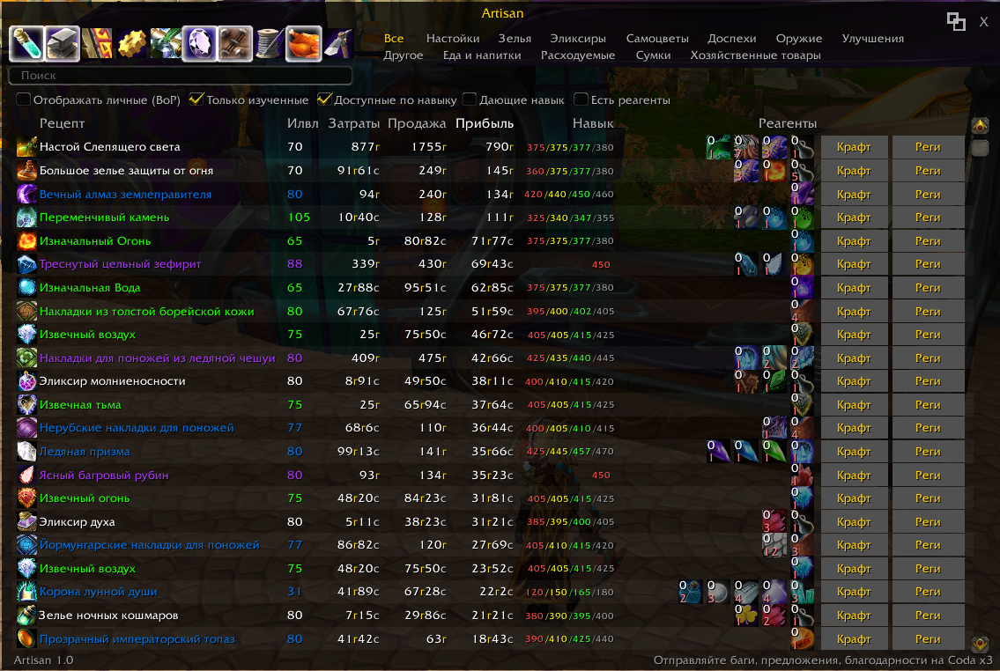
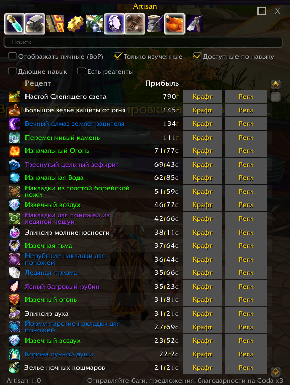
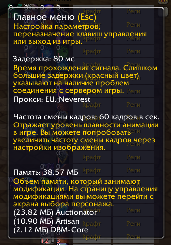

# Artisan

Помощник ремесленника. Вся база предметов профессий в одном списке, множество фильтров, расчет себестоимости и профита от крафта с учетом специализаций, отображение скила требуемого для крафта и не только. Для работы обязательно нужен аддон [Auctionator](https://sirus.su/base/addons/Auctionator)

## Возможности

### Огромная база предметов включая кастомные sirus, в виде одного списка с удобными фильтрами

### Компактный режим для удобной работы с ауком/профами

### Комбинация фильтров + сортировка по цене крафта - отображает самые дешевые предметы для прокачки профессии с подсказкой как получить рецепт

### Кнопка Реги ищет сразу все реагенты необходимые для крафта предмета на ауке

### Минимальное потребление ресурсов клиента

### Список рецептов
- Вывод всех рецептов выбранных профессий с иконками, названиями и качеством.
- Фильтр «Только изученные» — показывает только выученные рецепты.
- Фильтр «Доступные по навыку» — рецепты, доступные при текущем уровне профессии.
- Фильтр «Дающие навык» — скрывает «серые» рецепты (не дающие прогресс навыка).
- Фильтр «Отображать личные (BoP)» — управляет показом персональных предметов.
- Фильтр «Есть реагенты» — только те рецепты, для которых есть все компоненты.
- Строка поиска по названию рецепта и фильтр по подкатегории.

### Навык и прогресс
- Отображение уровня навыка по каждой профессии.
- Разбивка оранжевый / жёлтый / зелёный / серый для рецептов относительно текущего навыка.

### Прибыль
- «Базовая прибыль» каждого рецепта (затраты против продажи).
- Учёт специализации алхимии.
- Данные о ценах/продажах берутся из Auctionator.

### Реагенты
- Отображение необходимых реагентов и их текущего количества в сумке прямо в строке рецепта.
- Кнопка перехода для просмотра/крафта.

## Установка

1. Скопируйте папку `Artisan` в `Interface\AddOns\`.
3. Для отображения цен (прибыли) обязателен [Auctionator](https://sirus.su/base/addons/Auctionator).

## Связь

Coda x3
Дис stratocaster